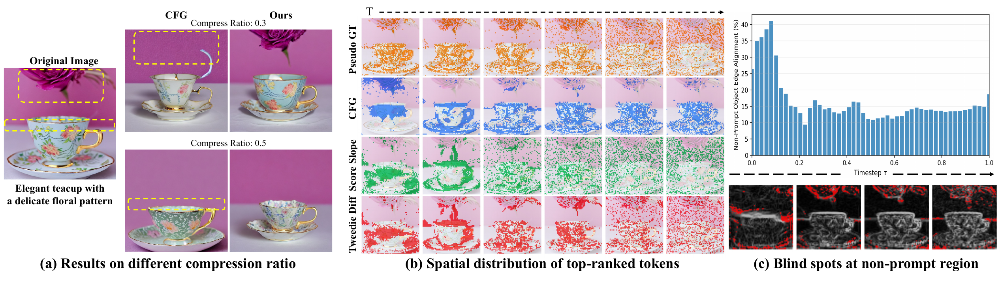
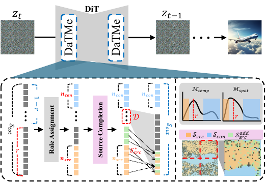
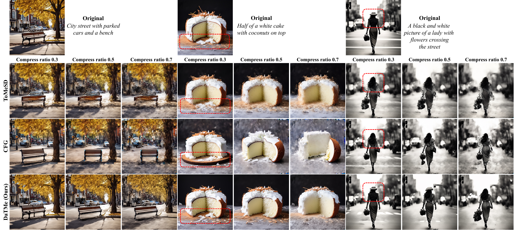
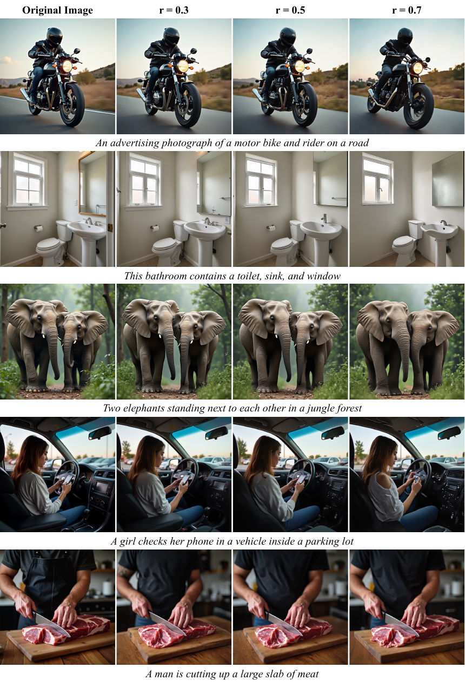

<div align="center">

<h1 align="center">
  &nbsp;
  Which Tokens to Merge? Diffusion Dynamics for Efficient Image Generation
</h1>

### NeurIPS 2026

[*SeungJu Cha*](https://scholar.google.com/citations?user=lVmI_MgAAAAJ&hl=ko)&nbsp;([LinkedIn](https://www.linkedin.com/in/seungju-cha-3a3061301/?isSelfProfile=true))&nbsp;·&nbsp;[*Ye-Chan Kim*](https://scholar.google.com/citations?user=HBHVFMIAAAAJ&hl=ko)&nbsp;·&nbsp;[*HyunGee Kim*](https://scholar.google.com/citations?user=Bzq0v-4AAAAJ&hl=ko)&nbsp;·&nbsp;[*Sungho Koh*](https://openreview.net/profile?id=~Sungho_Koh1)&nbsp;·&nbsp;*Dong-Jin Kim*

**📄 Paper · arXiv: coming soon**

<!-- Replace the line above with: [Paper](PAPER_URL) · [arXiv](ARXIV_URL) -->

<table>
<tr>
<td width="70%" align="center"><b>Motivation</b></td>
<td width="30%" align="center"><b>DaTMe Pipeline</b></td>
</tr>
<tr>
<td></td>
<td></td>
</tr>
</table>

</div>

---

## Official Implementation

This repository contains the official NeurIPS 2026 implementation of **DaTMe**.
It provides generation entry points and DaTMe pipelines for:

- Stable Diffusion 1.5
- Stable Diffusion XL
- PixArt-α
- FLUX.1-dev

## Installation

The code was tested with Python 3.10, PyTorch 2.9.0, diffusers 0.30.2,
transformers 4.44.2, and accelerate 0.34.0. FLUX requires the pinned diffusers
version because later transformer call signatures are incompatible with this
implementation. Install the PyTorch build matching your CUDA driver from the
[official installation selector](https://pytorch.org/get-started/locally/), then
install the remaining pinned dependencies:

```bash
pip install -r requirements.txt
```

## Generation

Run the commands from the repository root. `--compression_ratio` is the fraction of
image tokens removed by merging. Add `--deterministic` when exact repeatability
is required. Deterministic mode disables Flash SDP, memory-efficient SDP, TF32,
and cuDNN benchmarking, so generation can be slower, especially for FLUX.

### Stable Diffusion 1.5

```bash
python -m generation.sd_generate \
  --compression_ratio 0.3 \
  --prompt "A bowl of oatmeal is ready to eat with some cinnamon and sugar"
```

### Stable Diffusion XL

```bash
python -m generation.sdxl_generate \
  --compression_ratio 0.3 \
  --prompt "A giraffe and its kid in a grassy pin"
```

### PixArt-α

```bash
python -m generation.pixart_generate \
  --compression_ratio 0.3 \
  --prompt "An old man is wearing an odd hat"
```

### FLUX.1-dev

```bash
python -m generation.flux_generate \
  --compression_ratio 0.3 \
  --deterministic \
  --prompt "An old toilet with a hello kitty cover top"
```

For lower GPU memory use, add `--cpu_offload`. Omit it when validating
pixel-level reproduction against the reference GPU execution path.

Complete, editable commands are collected in
[`scripts/generate_all.sh`](scripts/generate_all.sh). Each model block exposes
its sampling, resolution, merge schedule, spatial partition, and layer or block
settings. Enable the model blocks you want to run, edit the values, then execute:

```bash
PYTHON_BIN=python bash scripts/generate_all.sh
```

Generated images are saved as PNG files under:

```text
outputs/
├── sd/
├── sdxl/
├── pixart/
└── flux/
```

## Qualitative Results

### PixArt-α

<p align="center">
  
</p>

### FLUX.1-dev

<p align="center">
  
</p>

## Citation

```bibtex
@misc{cha2026tokensmergediffusiondynamics,
  title={Which Tokens to Merge? Diffusion Dynamics for Efficient Image Generation},
  author={SeungJu Cha and Ye-Chan Kim and HyunGee Kim and Sungho Koh and Dong-Jin Kim},
  year={2026},
  eprint={2610.22370},
  archivePrefix={arXiv},
  primaryClass={cs.CV},
  url={https://arxiv.org/abs/2610.22370},
}
```
